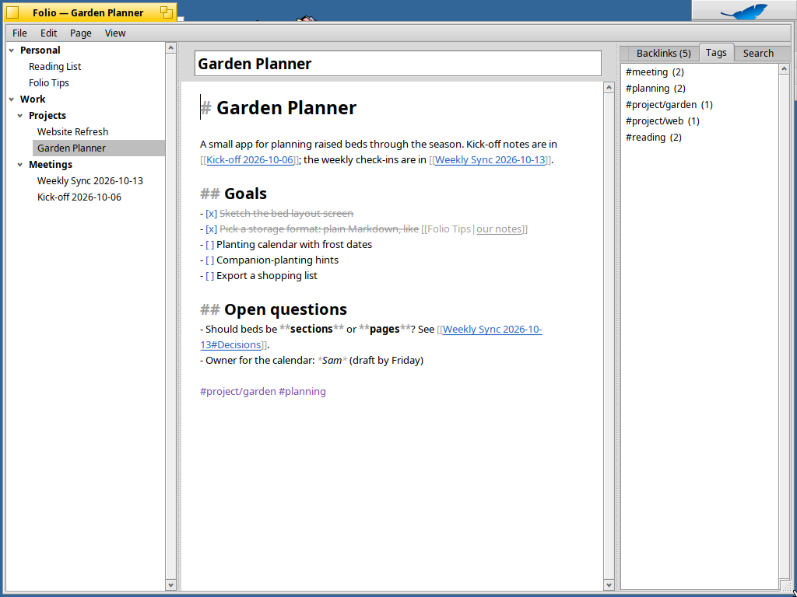
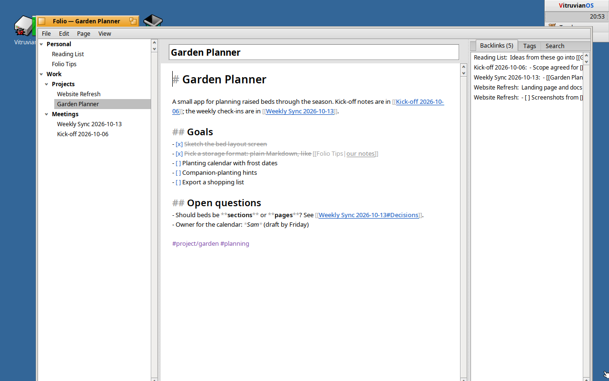
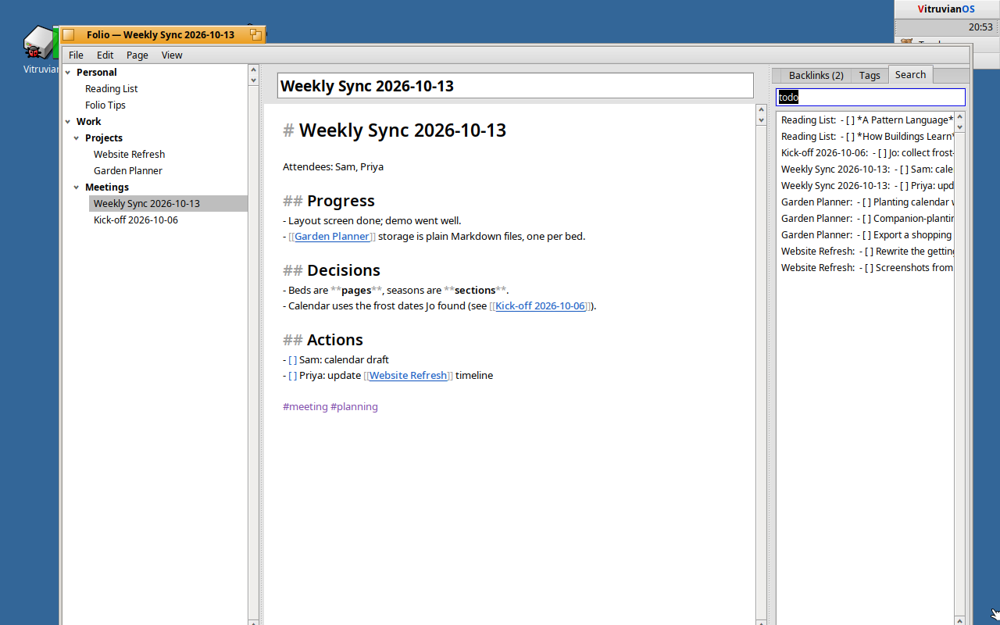
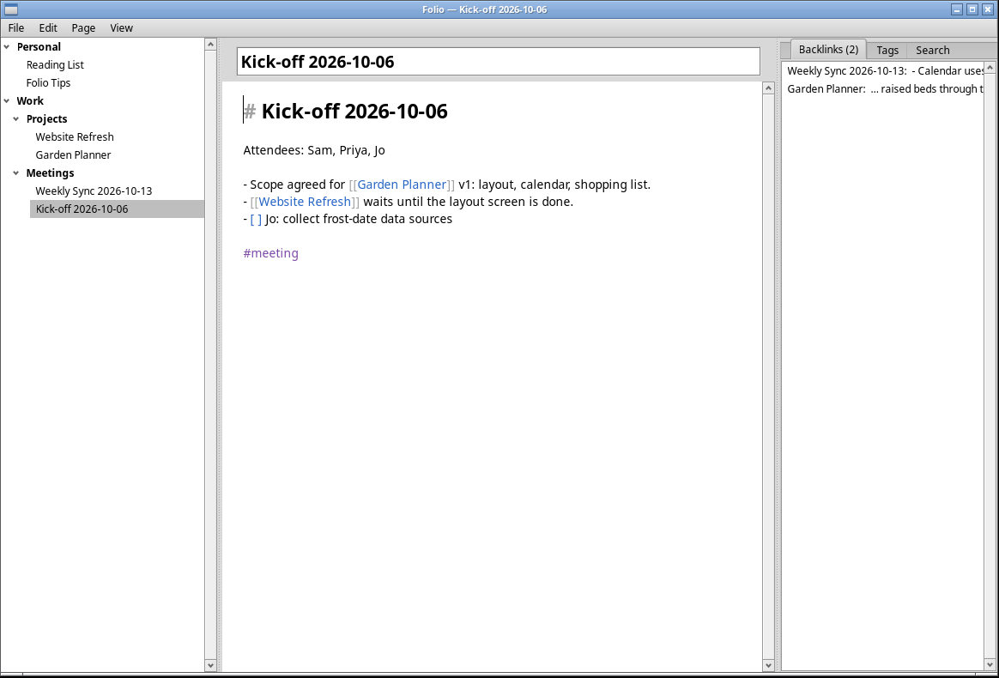
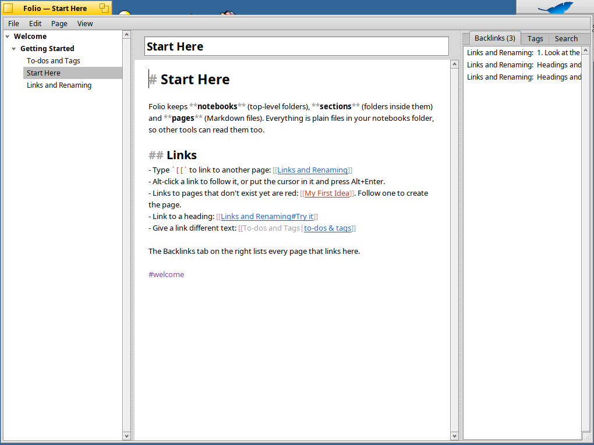
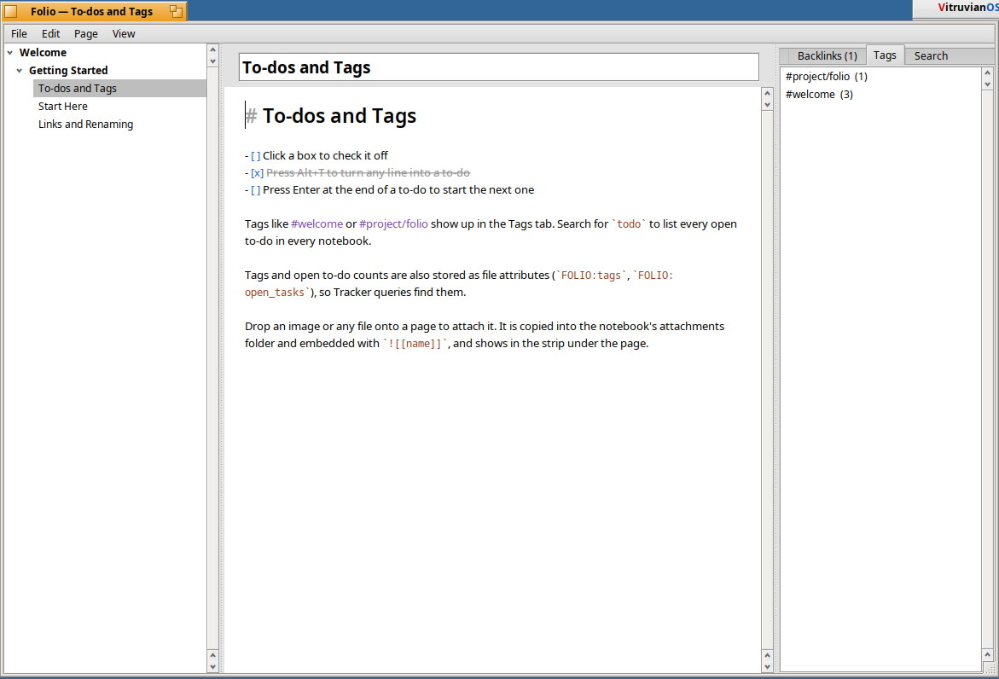
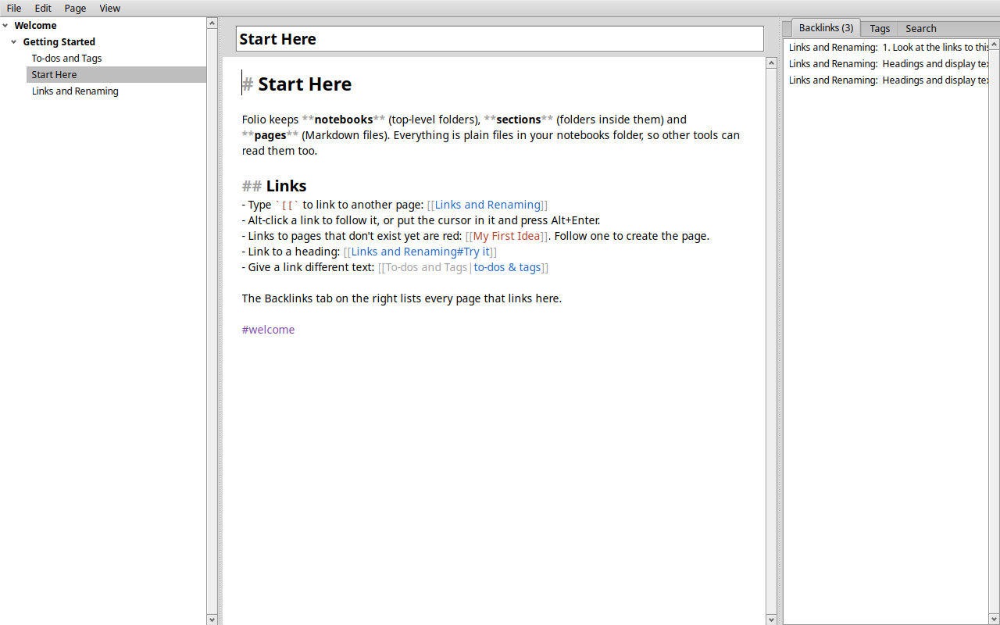

# Folio

A native notebook app for **Haiku**, **VitruvianOS** and **Linux**, in the
spirit of OneNote, with Obsidian-style `[[wiki links]]` that rewrite themselves when you
rename or move the page they point to. It is written from scratch against the
Be/Haiku API, since OneNote's own source is closed.

One source tree builds for all three, and each gets its own package:

| System | Package | Tested on |
|---|---|---|
| **Haiku** R1/beta6 or later, x86_64 | `folio-0.1.3-1-x86_64.hpkg` | R1/beta6 (hrev59866) |
| **VitruvianOS** 0.6.x, amd64 | `folio_0.1.3-1_amd64.deb` | 0.6.2 |
| **VitruvianOS** 0.6.x, arm64 | `folio_0.1.3-1_arm64.deb` | not run (built and checked in CI) |
| **Linux**, x86_64: Ubuntu 24.04, Fedora 39, Debian 13 or newer | `Folio-0.1.3-x86_64.AppImage` | CachyOS (X11) |

All three are on the [Releases page](https://github.com/idumych/folio/releases).
On Linux, Folio runs on [Kireji](https://github.com/idumych/kireji), a fork of
[Cosmoe](https://github.com/haydentech/cosmoe), which provides the Haiku API
as a library on X11 and Wayland, and the AppImage bundles it. The Haiku and VitruvianOS packages were installed and tested
on those systems in VirtualBox; the AppImage was tested on X11. The tests
covered:

* installing the package, the Deskbar entry, and the `folio` command
* the Welcome notebook created on first launch
* renaming a page in Folio, and with `mv` in a terminal while Folio runs:
  every link is rewritten, keeping `#heading` and `|alias` as written
* following a link to a missing page, which creates it
* to-do checkboxes, tags, search, and backlinks
* attaching files through the file panel, plus drag and drop from Tracker
  (tested on VitruvianOS)
* Move to Trash, which Tracker can restore from (restore tested on
  VitruvianOS); on Linux the page goes to the desktop Trash
  (`~/.local/share/Trash`) with a `.trashinfo` record
* the `FOLIO:tags` and `FOLIO:open_tasks` attributes; on Haiku they are
  indexed, and file-system queries find them

The unit tests (`make test`) also run in CI on every push.



*Folio on Haiku R1/beta6.*





*Folio on VitruvianOS 0.6.2.*



*Folio on Linux (X11), from the AppImage.*

## Screenshots



*Haiku R1/beta6: wiki links, a missing page in red, and the backlinks tab.*



*VitruvianOS 0.6.2: to-do checkboxes and the Tags tab.*



*Linux, Wayland (headless sway in CI), from the AppImage.*

## Build and run

VitruvianOS (V\OS) runs Haiku applications recompiled from source on a
Linux kernel. The Makefile detects which system it is on.

**Haiku** (R1/beta6 or later, x86_64): download
`folio-0.1.3-1-x86_64.hpkg` from the
[Releases page](https://github.com/idumych/folio/releases), then:

```sh
pkgman install ./folio-0.1.3-1-x86_64.hpkg
```

This installs Folio in `/boot/system/apps`, adds it to the Deskbar's
Applications menu, and adds a `folio` command. To build from source
instead, install `gcc`, `make` and `haiku_devel` with `pkgman`, then run
`make && ./Folio`. `make hpkg` builds the package.

**Linux** (x86_64): download `Folio-0.1.3-x86_64.AppImage` from the
[Releases page](https://github.com/idumych/folio/releases), then:

```sh
chmod +x Folio-0.1.3-x86_64.AppImage
./Folio-0.1.3-x86_64.AppImage
```

It needs nothing installed beyond a normal desktop. Cosmoe picks Wayland
or X11 automatically; set `COSMOE_BACKEND=x11` (or `wayland`) to choose.
To build it yourself, `sh packaging/appimage/build-appimage.sh` builds
Kireji and then the AppImage (see the script for the
packages it needs). With Cosmoe installed, `make` builds `./Folio`
directly (`COSMOE_ROOT` points at its prefix, default `/usr`).

**VitruvianOS**: the quickest way is the package. Download
`folio_0.1.3-1_amd64.deb` from the
[Releases page](https://github.com/idumych/folio/releases), then:

```sh
sudo apt install ./folio_0.1.3-1_amd64.deb     # or _arm64.deb on ARM
```

This puts Folio in `/system/apps`, adds it to the Deskbar's Applications
menu, and adds a `folio` command. It is built for VitruvianOS 0.6.x on
amd64 and arm64 and needs a rebuild for 0.7.

To build from source on VitruvianOS:

```sh
sudo apt install build-essential
make && ./Folio
```

VitruvianOS 0.6.x ships its headers in `/system/develop/headers`, and the
Makefile uses them from there. Newer builds that have the `vos-dev` package
are picked up through `pkg-config vos` instead. The Makefile then links
`libbe`, `libroot`, `libtracker` and `libtranslation`. It embeds the app
signature with `rc`, `xres` and `resattr`; VitruvianOS keeps it both as
resources and as attributes.

`make deb` (or `sh packaging/build-deb.sh`) builds the package; release
packages come from CI (`.github/workflows/deb.yml`, Debian trixie). On
VitruvianOS the attributes are Linux extended attributes, which dpkg
doesn't preserve, so the package carries them in
`/usr/share/folio/apps_attrs.tar`. Its install script copies them onto the
installed binary, the same way VitruvianOS's own package does for the
bundled apps.

Both systems also support `make install` and `make test`. The tests cover
the link engine only, so they run on any OS.

On first launch Folio creates `~/Notebooks` with a short **Welcome** notebook
that walks through the features. Use *File ▸ Open Notebooks Folder…* to point
it at any other folder, including an existing Obsidian vault.

### Differences on VitruvianOS

* **Renames in other apps.** Folio reads both systems' file-change
  messages. Haiku identifies files by device and inode numbers, while
  VitruvianOS sends `virtual:node` and directory `entry_ref`s. If a node
  can't be identified, Folio falls back to the file's path. Renames made
  in Tracker or a terminal update links on both systems.
* **Tags and to-dos in Tracker.** `FOLIO:tags` and `FOLIO:open_tasks` are
  stored as Linux extended attributes. ext4, the default, supports them.
  VitruvianOS doesn't have file indexing or live queries yet; its roadmap
  lists them next. Until then Tracker queries won't find these attributes,
  but Folio's own Search tab works the same as on Haiku.
* **Trash.** VitruvianOS uses the freedesktop.org Trash layout, kept in
  `~/config/data/Trash` (`files/` plus `info/`). *Move to Trash* writes the
  matching `.trashinfo` record, so Tracker's *Restore* puts the page back
  where it was.
* **Web links.** These open through the `application/x-vnd.Be.URL.*`
  handlers, so they need VitruvianOS's URL wrapper to be set up.
* **Shortcuts.** The README says "Alt" because that is the default
  command key on Haiku. On VitruvianOS's default keymap the command key
  is Ctrl, so Ctrl+R renames, Ctrl+N makes a new page, and so on.

### Differences on Linux (Cosmoe)

* **Shortcuts** use Ctrl, as on VitruvianOS.
* **Show in File Manager** (Tracker on the other systems) and links to
  attachments and web pages open with `xdg-open`, so they go to your
  desktop's own apps.
* **Settings** are in `~/.config/cosmoe/Folio_settings`; notebooks are in
  `~/Notebooks` as everywhere else. Cosmoe itself creates a `~/cosmoe`
  folder for its own settings.
* **Looks:** Cosmoe doesn't draw underlined or struck-through text yet, so
  links are shown in colour only and done to-dos in grey.
* **Not yet tested:** the Wayland backend, and dragging files in from a
  Linux file manager.

## How it is organised

| OneNote  | Folio                        | On disk                                |
|----------|------------------------------|----------------------------------------|
| Notebook | top-level folder             | `~/Notebooks/Work/`                    |
| Section  | sub-folder (any depth)       | `~/Notebooks/Work/Meetings/`           |
| Page     | Markdown file                | `~/Notebooks/Work/Meetings/Standup.md` |
| Images / files | attachments            | `~/Notebooks/Work/attachments/`        |

Pages are plain UTF-8 Markdown, so other editors, `grep`, Git and Obsidian
can all use them. Folio also writes two indexed BFS attributes on every page:
`FOLIO:tags` and `FOLIO:open_tasks`. That lets Tracker queries find, for
example, every page tagged `#project` or every page with open to-dos.

## Links

* `[[Page]]`, `[[Page#Heading]]`, `[[Page|shown text]]`, `![[image.png]]`
  (embed), and ordinary `[text](relative/path.md)` Markdown links all work.
* Type `[[` to pick a page from a menu.
* **Alt-click** a link to follow it, or put the cursor in it and press
  **Alt+Enter**. Following a link to a page that doesn't exist (shown in red)
  creates it.
* The **Backlinks** tab lists every page that links to the current one, with
  the line around each link.

### What happens when you rename

When you rename or move something, Folio first works out what every link in
the notebooks folder pointed to, then rewrites only the part of each link
that names the target. The rest is kept as written: `#heading`, `|alias`, the
`!` of an embed, and a `.md` extension if you wrote one.

This covers:

* renaming a page (edit its title above the page and press Enter, or Alt+R);
* moving a page to another section or notebook (*Page ▸ Move To*, or the
  tree's context menu);
* renaming or moving a whole section or notebook, which updates every link
  into and out of it, including relative `[x](../Other.md)` links in the
  moved pages themselves;
* renames and moves done in **Tracker or Terminal** while Folio is running,
  caught through Haiku's node monitor;
* name collisions. If renaming makes `[[Ideas]]` ambiguous, links that meant
  the other page are rewritten to a path such as `[[Home/Ideas]]`.

Like Obsidian, links are written in the shortest form that is still
unambiguous, and links that were already broken are left alone.

## Pages

* Live Markdown styling: headings, **bold**, *italic*, `code`, code blocks,
  quotes, links, #tags. The Markdown syntax characters are dimmed rather
  than hidden.
* **To-dos:** click a `[ ]` box to tick it. Alt+T turns any line into a
  to-do, and Enter continues a to-do, bullet or numbered list.
* **Tags:** `#tag` and `#nested/tag`. The **Tags** tab lists them with
  counts; click one to search for it.
* **Search** (Alt+F): words, `"exact phrases"`, `#tag` or `tag:x`, `path:x`,
  and `todo` / `done` to list to-dos across all notebooks.
* **Attachments:** drop files onto a page or use *Page ▸ Attach File…*
  (Alt+I). Files are copied into the notebook's `attachments` folder and
  linked; images are embedded. Everything a page links to appears as
  thumbnails under the page. Click a thumbnail to open it.
* Pages autosave about a second after you stop typing.
* Back and forward with Alt+[ and Alt+]. *Move to Trash* uses the real
  Trash, and Tracker can restore from it.

## Shortcuts

| Keys            | Action                     |
|-----------------|----------------------------|
| Alt+N           | New page                   |
| Alt+Shift+N     | New section                |
| Alt+R           | Rename page                |
| Alt+K           | Insert link                |
| Alt+T           | To-do on/off               |
| Alt+I           | Attach file                |
| Alt+Enter       | Follow link at cursor      |
| Alt+F           | Search                     |
| Alt+[ / Alt+]   | Back / forward             |
| Alt+J           | Show/hide the side panel   |

## Code layout

* `src/MarkdownScan.*` finds links, tags, to-dos and styling spans; it skips
  code spans and code blocks.
* `src/LinkGraph.*` is the in-memory index. It handles link resolution,
  backlinks, search, tags, and the rename planner (`PlanMoves`).
* `src/Vault.*` handles the files on disk: loading, saving, BFS attributes,
  moves, Trash, attachments and node monitoring.
* `src/NoteView.*` is the editor, a stylable `BTextView`.
* `src/MainWindow.*`, `src/Widgets.*` and `src/App.cpp` are the rest of the
  user interface.

The first two use only portable C++ and are covered by `tests/test_core.cpp`.

Tools for working on a Linux host:

* `tools/haiku-typecheck.sh` type-checks the user-interface code
  against Haiku's real headers.
* `tools/vos-sdk/make-sdk.sh` builds VitruvianOS 0.6.2's libraries from
  source on Debian trixie (amd64 or arm64), so `make deb` works without a
  VitruvianOS machine; CI uses it to build the release packages.
* `tools/mockups/` regenerates the mockup screenshots.

`docs/HANDOFF.md` records the design decisions and what has been verified.

## Known limits (v0.1)

* Pages are flowing rich text, not OneNote's free-form canvas.
* Images appear in the strip under the page, not inline in the text.
* Renaming a *heading* does not yet update `[[Page#Heading]]` links.
* A page that is already open is not reloaded if another app edits it.
  Switching away and back picks up the change.
* Case-insensitive name matching covers ASCII letters only.
* There is no app icon yet.
* Folio has been built and linked against VitruvianOS 0.6.2's own
  libraries, but not yet run on it. VitruvianOS is itself pre-1.0.
